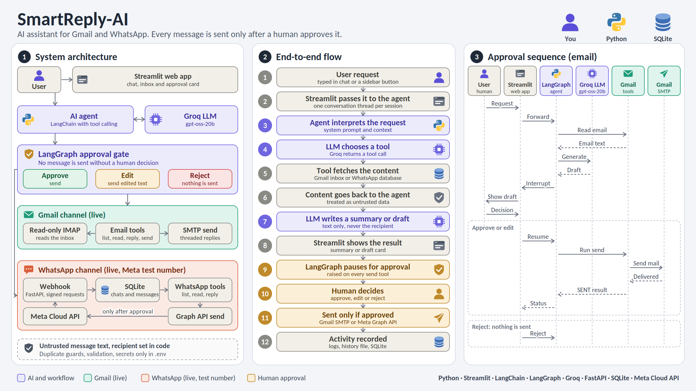
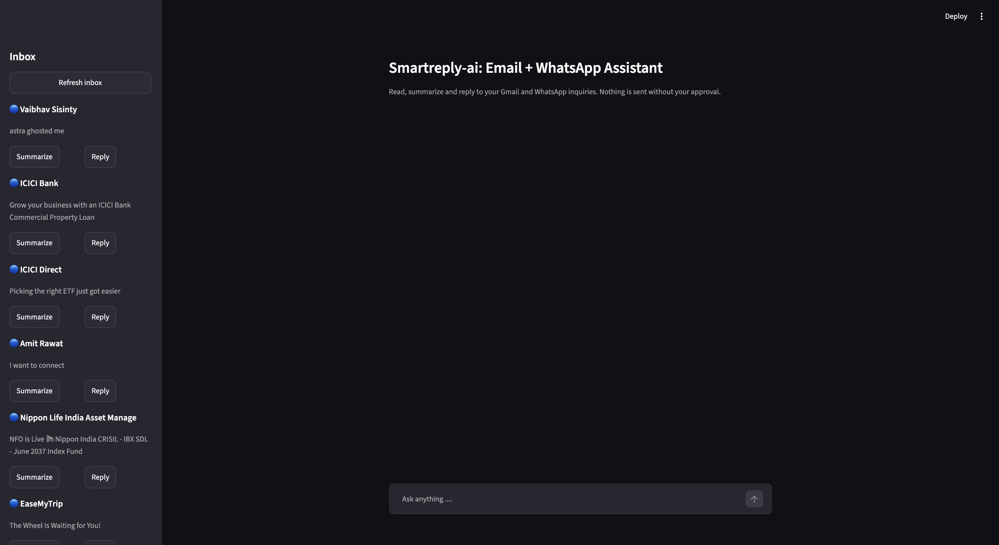
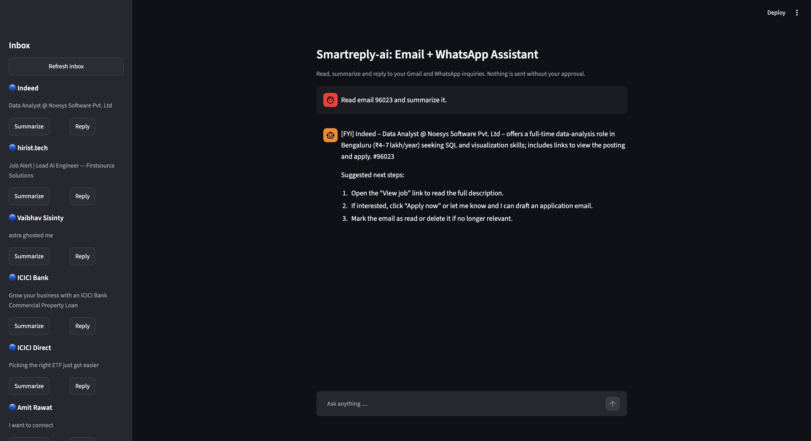
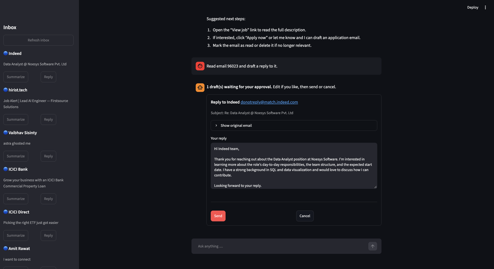
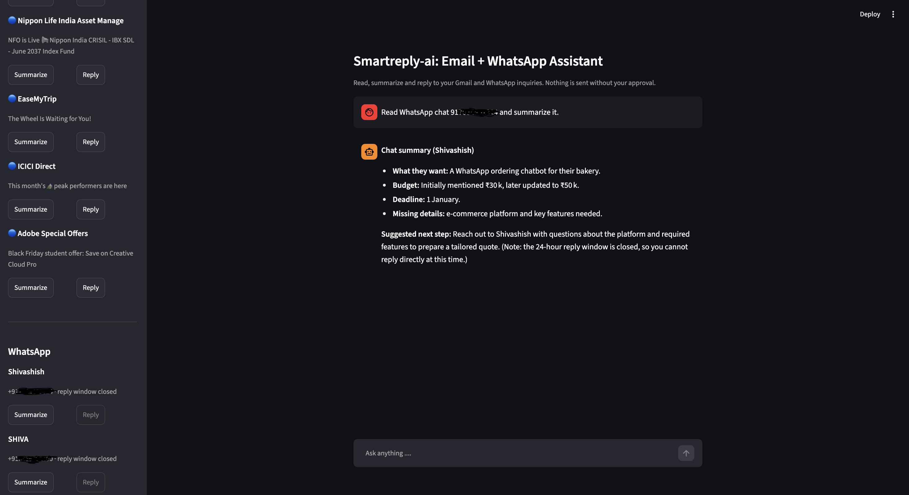

# SmartReply-AI

**AI-Powered Email & WhatsApp Business Communication Assistant**


SmartReply-AI is a Streamlit application backed by a tool-calling LLM agent. It reads and summarizes Gmail messages, reads WhatsApp Business inquiries, and drafts replies. **Nothing is sent until the user reviews, optionally edits, and approves the draft.**


---

## Table of Contents

1. [Overview](#overview)
2. [Key Features](#key-features)
3. [Architecture](#architecture)
4. [Technology Stack](#technology-stack)
5. [How It Works](#how-it-works)
6. [Project Structure](#project-structure)
7. [Installation and Setup](#installation-and-setup)
8. [Environment Variables](#environment-variables)
9. [WhatsApp Setup and Local Testing](#whatsapp-setup-and-local-testing)
10. [Screenshots / Demo](#screenshots--demo)
11. [Security and Responsible AI](#security-and-responsible-ai)
12. [Testing](#testing)
13. [Current Limitations](#current-limitations)
14. [Future Improvements](#future-improvements)
15. [Learning Outcomes](#learning-outcomes)
16. [Author](#author)

---

## Overview

People who run freelance or small-business work often receive client questions in two places: a Gmail inbox and a business WhatsApp number. Triaging both, summarizing long threads, and writing consistent, polite replies is repetitive work that is easy to get wrong when done quickly.

SmartReply-AI puts an LLM agent in front of both channels:

- It reads the inbox and WhatsApp chats through dedicated tools and produces summaries (what the sender wants, urgency, suggested next step).
- It drafts replies in a configurable tone, using only facts supplied by the user (a profile file for WhatsApp, the chat for email).
- Every outgoing message is routed through a **human-in-the-loop approval card**. The user can send as-is, edit the text, or cancel.

The agent never sends on its own: sending tools are gated by LangChain's `HumanInTheLoopMiddleware`.

---

## Key Features

### Implemented

| Area | Feature |
|---|---|
| Email | List and search the Gmail inbox (sender, subject, text, unread, last N days) over IMAP, read-only |
| Email | Read a single email (HTML converted to text, quoted replies stripped, body capped at 3,000 characters) |
| Email | Summaries and prioritized digests (`[URGENT]`, `[NEEDS REPLY]`, `[FYI]`) driven by the system prompt |
| Email | Threaded replies (`In-Reply-To` / `References` set) and new emails over SMTP |
| WhatsApp | FastAPI webhook receiving messages from Meta's WhatsApp Cloud API, with signature verification |
| WhatsApp | SQLite storage of chats and messages, delivery-status tracking, 24-hour reply window tracking |
| WhatsApp | Chat listing, reading, summarizing, and replying through agent tools |
| Agent | Tool-calling agent built with `langchain.agents.create_agent` and a Groq-hosted model |
| Agent | Human approval with approve / edit / reject decisions for `send_email`, `reply_to_email`, `reply_whatsapp` |
| Agent | Per-browser-session conversation memory (LangGraph `InMemorySaver`, one `thread_id` per Streamlit session) |
| UI | Streamlit chat interface, inbox sidebar with Summarize / Reply buttons, live-refreshing WhatsApp panel (every 5 s) |
| Safety | Input validation, duplicate-send protection, untrusted-content markers, recipient locked to the original sender or chat (see [Security](#security-and-responsible-ai)) |

### Partially implemented

- **WhatsApp** is complete in code and has automated tests, and the log history shows real sends through Meta's API. It is optional (`WHATSAPP_ENABLED`) and limited to text messages; incoming media is stored as a placeholder such as `[image received]`, not downloaded or analyzed.
- **Observability**: file logging exists (`email_agent.log`, `whatsapp_webhook.log`), but there is no metrics or tracing layer.

### Planned

See [Future Improvements](#future-improvements).

---

## Architecture

```mermaid
flowchart TD
    User([User]) --> UI["Streamlit UI"]
    UI -->|chat message / sidebar button| Agent["LangChain agent<br/>create_agent + InMemorySaver"]
    Agent <-->|prompts and tool calls| LLM["Groq LLM<br/>ChatGroq, model set by MODEL"]

    Agent -->|read-only tools| ReadTools["list_emails, read_email<br/>list_chats, read_chat"]
    Agent -->|sending tools| HITL{"HumanInTheLoopMiddleware<br/>interrupt"}

    ReadTools --> IMAP["Gmail IMAP, read-only"]
    ReadTools --> Store[("SQLite")]

    HITL -->|draft shown| Approval["Approval card in UI<br/>approve / edit / reject"]
    Approval -->|decision| HITL

    HITL -->|approved| SendTools["send_email, reply_to_email<br/>reply_whatsapp"]
    SendTools --> SMTP["Gmail SMTP"]
    SendTools --> WAAPI["Meta Graph API"]
    SendTools --> Store

    Meta["Meta WhatsApp Cloud API"] -->|POST /webhook, signed| Webhook["FastAPI"]
    Webhook --> Store
    WAAPI --> Meta
    SMTP --> Gmail["Gmail"]
    IMAP --> Gmail


    
```

### Components

| Component | Responsibility |
|---|---|
| `app.py` | Streamlit UI: chat, inbox sidebar, WhatsApp panel, and the approval form. Handles agent interrupts and resumes the graph with the user's decisions. |
| `agent.py` | Builds the system prompt (email rules, plus WhatsApp rules and the user profile when `WHATSAPP_ENABLED`) and creates the agent with the human-in-the-loop middleware. |
| `tools.py` | Email tools (`list_emails`, `read_email`, `reply_to_email`, `send_email`), validation, SMTP delivery, and duplicate protection persisted in `sent_history.json`. |
| `gmail_imap.py` | Read-only IMAP access (`BODY.PEEK`, read-only mailbox), header parsing, HTML-to-text conversion. |
| `whatsapp_tools.py` | WhatsApp tools (`list_chats`, `read_chat`, `reply_whatsapp`) with window, allowlist, length and duplicate checks. |
| `whatsapp_api.py` | Sends text messages through Meta's Graph API and translates Meta error codes into readable messages. |
| `whatsapp_store.py` | SQLite persistence for chats and messages, status updates, and the 24-hour window logic. |
| `webhook.py` | FastAPI receiver for Meta's webhook: verification handshake, HMAC signature check, message and status ingestion. |

---

## Technology Stack

| Category | Technologies |
|---|---|
| Language | Python (3.10+; the code uses `X \| None` type syntax) |
| Frontend | Streamlit |
| LLM | Groq-hosted model via `langchain-groq` (`ChatGroq`); model name comes from the `MODEL` variable |
| Agent framework | LangChain (`create_agent`, `HumanInTheLoopMiddleware`), LangGraph (`InMemorySaver`, `Command` for resuming interrupts) |
| Communication | Gmail IMAP (`imaplib`) and SMTP (`smtplib`); WhatsApp Business Cloud API (Meta Graph API) |
| APIs / web | FastAPI + Uvicorn (webhook), `requests` (Graph API calls) |
| State / storage | LangGraph `InMemorySaver` (conversation), SQLite (WhatsApp data), JSON file (send history) |
| Dev tools | `python-dotenv`, `pytest`, FastAPI `TestClient`, ngrok (optional, for exposing the webhook; see `policy.yaml`) |

Dependencies are listed in `requirements.txt`: `langchain`, `langchain-groq`, `langgraph`, `streamlit`, `python-dotenv`, `fastapi`, `uvicorn`, `requests`, `httpx`, `pytest`.

---

## How It Works

### 1. Reading and summarizing emails

1. The user clicks **Refresh inbox** (sidebar) or asks "what's new in my inbox?" in the chat.
2. The agent calls `list_emails`, which queries Gmail over IMAP without changing read/unread state.
3. For the relevant messages the agent calls `read_email` (at most 5 at once by default, per the system prompt).
4. The agent returns a digest, one line per email with a label, sender, subject, a one-sentence gist, the message id, and up to three suggested next steps. The sidebar **Summarize** button does the same for a single email.

### 2. Generating and approving email replies

1. The user clicks **Reply** on an inbox item, or asks for a reply in chat.
2. The agent reads the email, then calls `reply_to_email(uid, body)`. It never supplies a recipient or subject; both are derived from the original message.
3. `HumanInTheLoopMiddleware` interrupts before the tool runs. The UI shows the recipient, subject, a collapsible view of the original email, and an editable text box.
4. **Send** resumes the agent with `approve` (unchanged) or `edit` (modified text). **Cancel** resumes with `reject`.

### 3. Processing WhatsApp Business messages

1. Meta calls `POST /webhook`. `webhook.py` verifies the `X-Hub-Signature-256` HMAC, then stores new messages (deduplicated by message id) and delivery statuses in SQLite.
2. The sidebar WhatsApp panel refreshes every 5 seconds and shows chats, unread markers, and whether the 24-hour reply window is open.
3. **Summarize** or **Reply** queues a prompt for the agent, which calls `read_chat` (and marks the chat read) and then summarizes or drafts a short plain-text reply using only facts from `my_profile.md`.

### 4. Sending approved responses

1. After approval, the tool re-validates everything server-side: address format, non-empty body, no automated/no-reply recipients, duplicate history, and for WhatsApp the allowlist, length limit, and reply window.
2. Email goes out over Gmail SMTP (SSL, port 465). WhatsApp goes through the Graph API and the outbound message is saved to SQLite.
3. The tool returns `SENT:` or `NOT SENT:` with the reason, and the UI shows that result.

---

## Project Structure

```text
.
├── app.py                 # Streamlit UI and approval workflow
├── agent.py               # System prompt, model, middleware, agent factory
├── tools.py               # Email tools, validation, SMTP, duplicate protection
├── gmail_imap.py          # Read-only Gmail IMAP client
├── whatsapp_tools.py      # WhatsApp agent tools
├── whatsapp_api.py        # Meta Graph API sender
├── whatsapp_store.py      # SQLite chat/message store
├── webhook.py             # FastAPI webhook for Meta
├── fake_whatsapp.py       # Sends a signed fake message to the local webhook
├── check_meta.py          # Checks/creates the Meta app <-> WhatsApp Business Account link
├── test_whatsapp.py       # pytest suite for webhook, store, and WhatsApp tools
├── my_profile.md          # Facts about the user that the WhatsApp assistant may use
├── policy.yaml            # ngrok traffic policy (Google OAuth gate)
├── basic_langchain.ipynb  # Learning notebook (LangChain basics, memory, middleware)
├── requirements.txt
│
│  # Generated at runtime (recommended: do not commit)
├── whatsapp.db            # SQLite database (path set by WA_DB_PATH)
├── sent_history.json      # Duplicate-send history
├── email_agent.log        # Agent and email log
└── whatsapp_webhook.log   # Webhook log
```


---

## Installation and Setup

### Prerequisites

- Python 3.10 or newer
- A [Groq](https://console.groq.com) API key
- A Gmail account with IMAP enabled and a [Google app password](https://support.google.com/accounts/answer/185833) (requires 2-step verification)
- For WhatsApp (optional): a Meta developer app with the WhatsApp product, and a public HTTPS URL for the webhook (for example via ngrok)

### Steps

```bash
# 1. Clone
git clone <https://github.com/Shiva-netizen/SmartReply-AI.git>   
cd SmartReply-AI                 

# 2. Create a virtual environment
python -m venv .venv

# 3. Activate it
source .venv/bin/activate         # macOS / Linux
.venv\Scripts\activate            # Windows (cmd / PowerShell)

# 4. Install dependencies
pip install -r requirements.txt

# 5. Configure environment variables
cp .env.example .env              # or create .env manually; see the next section

# 6. Run the Streamlit app
streamlit run app.py
```

To use WhatsApp, also run the webhook server in a second terminal (see [WhatsApp Setup](#whatsapp-setup-and-local-testing)):

```bash
uvicorn webhook:app --port 8000
```

Run both commands from the repository root: the app reads `.env`, `my_profile.md`, and the SQLite file relative to the working directory.

---

## Environment Variables

Create a `.env` file in the repository root. Never commit it.

```dotenv
# ---- LLM (required) ----
GROQ_API_KEY=your-groq-api-key
MODEL=openai/gpt-oss-20b

# ---- Gmail (required) ----
SENDER_EMAIL=you@gmail.com
SENDER_PASSWORD=your-16-character-app-password
SENDER_NAME=Your Name

# ---- WhatsApp (optional) ----
WHATSAPP_ENABLED=true
WA_ACCESS_TOKEN=your-permanent-system-user-token
WA_PHONE_NUMBER_ID=your-phone-number-id
WA_APP_SECRET=your-meta-app-secret
WA_VERIFY_TOKEN=any-string-you-choose
WA_WABA_ID=your-whatsapp-business-account-id
WA_GRAPH_VERSION=v23.0
WA_ALLOWED_NUMBERS=
WA_DB_PATH=whatsapp.db
WA_FAKE_SEND=false
```

| Variable | Required | Purpose | Where to get it |
|---|---|---|---|
| `GROQ_API_KEY` | Yes | Read by `langchain-groq` to authenticate `ChatGroq`. | Groq Console, API Keys |
| `MODEL` | Yes | Groq model name passed to `ChatGroq`. The example value is the one used in the project notebook. | [Groq model list](https://console.groq.com/docs/models); pick one that supports tool calling |
| `SENDER_EMAIL` | Yes | Gmail address used for IMAP and SMTP. | Your Gmail account |
| `SENDER_PASSWORD` | Yes | Gmail **app password** (spaces are stripped automatically). | Google Account, Security, App passwords |
| `SENDER_NAME` | No | Name used in the prompt and as the email sign-off. | Your choice |
| `WHATSAPP_ENABLED` | No | Enables WhatsApp tools, panel, and prompt. Set to `true`. | Your choice |
| `WA_ACCESS_TOKEN` | WhatsApp | Bearer token for the Graph API. Use a permanent system user token. | Meta Business Settings, System users |
| `WA_PHONE_NUMBER_ID` | WhatsApp | Phone number **ID** (digits only), not the phone number. | Meta App Dashboard, WhatsApp, API Setup |
| `WA_APP_SECRET` | WhatsApp | Verifies webhook signatures (`X-Hub-Signature-256`). Any value works for local fake testing. | Meta App Dashboard, App settings, Basic |
| `WA_VERIFY_TOKEN` | WhatsApp | Shared string for Meta's webhook verification handshake. | You choose it; enter the same value in Meta |
| `WA_WABA_ID` | Optional | Used only by `check_meta.py`. | Meta Business Manager |
| `WA_GRAPH_VERSION` | No | Graph API version, default `v23.0`. | Meta docs |
| `WA_ALLOWED_NUMBERS` | No | Comma-separated allowlist of numbers the agent may reply to. Empty means anyone who messaged first. | Your choice |
| `WA_DB_PATH` | No | SQLite file path, default `whatsapp.db`. | Your choice |
| `WA_FAKE_SEND` | No | `true` logs instead of calling Meta (local testing). | Your choice |

> **Note:** set `WHATSAPP_ENABLED=true` exactly. `app.py` only accepts `true` for its title and caption, while `agent.py` also accepts `1` and `yes`, so other values can make the UI and the agent disagree.

### Profile file

For WhatsApp, the assistant may only use facts from `my_profile.md` (name, services, availability, pricing policy, contact preference, portfolio). The file currently contains `<fill in>` placeholders; replace them before enabling WhatsApp, otherwise the agent will ask you for missing facts.

---

## WhatsApp Setup and Local Testing

**Against Meta (real messages)**

1. Start the webhook: `uvicorn webhook:app --port 8000`.
2. Expose it over HTTPS, for example `ngrok http 8000`. The repository includes `policy.yaml`, an ngrok traffic policy that adds a Google OAuth login gate. Its allowed domain is the placeholder `acme.com`, so edit it before use. Do not apply that policy to the webhook path Meta calls, because Meta cannot log in with Google.
3. In the Meta dashboard, set the callback URL to `https://<your-host>/webhook` and the verify token to your `WA_VERIFY_TOKEN`, then subscribe to the `messages` field.
4. Check or create the app-to-account link:

   ```bash
   python check_meta.py              # show the current link
   python check_meta.py --subscribe  # create it
   ```

**Locally, without Meta**

```bash
# in .env:  WA_APP_SECRET=anything   WA_FAKE_SEND=true
uvicorn webhook:app --port 8000
python fake_whatsapp.py "Hi, can you build me a website?"
python fake_whatsapp.py "Old message" --hours-ago 30                  # tests the closed 24h window
python fake_whatsapp.py "Hello" --from 918888888888 --name "Priya"
```

With `WA_FAKE_SEND=true`, approved replies are logged and stored but never leave your machine.

---

## Screenshots / Demo

| Screen | Why it is worth showing |
|---|---|
| Main chat with inbox sidebar | Shows the email digest and the Summarize / Reply buttons |
| Email approval card | Shows the editable draft and the collapsible original email (the human-in-the-loop step) |
| WhatsApp panel and reply approval | Shows unread markers, the reply-window status, and the recipient resolved from the database |
| Result line after sending | Shows the honest `SENT:` / `NOT SENT:` reporting |

## Screenshots / Demo

### Chat and inbox


### Email reply approval


### WhatsApp panel


### WhatsApp reply approval



---

## Security and Responsible AI

### Implemented controls

| Control | Where |
|---|---|
| **Human approval for every outgoing message**, with edit and reject options | `agent.py` (`HumanInTheLoopMiddleware`), `app.py` approval form |
| **Prompt-injection defenses**: the system prompt states that email and WhatsApp text is untrusted data; tool output wraps message bodies in explicit untrusted-content markers | `agent.py`, `tools.py`, `whatsapp_tools.py` |
| **Marker spoofing guard (WhatsApp)**: a message cannot fake the closing `CHAT_MESSAGES>>>` marker (covered by a test) | `whatsapp_tools.py`, `test_whatsapp.py` |
| **Recipient not controllable by the model**: email replies take the recipient and subject from the original message; WhatsApp replies go to the chat's own number; the approval card shows the recipient loaded from Gmail or the database, not from model text | `tools.py`, `whatsapp_tools.py`, `app.py` |
| **Input validation**: email address regex, single-line subject (blocks header injection), non-empty body, reply length limit, phone-number format | `tools.py`, `whatsapp_tools.py`, `whatsapp_api.py` |
| **Duplicate-send protection**: identical sends/replies blocked for a time window, persisted across restarts | `tools.py`, `whatsapp_store.py` |
| **Automated-address and self-reply blocking** | `tools.py` |
| **Read-only inbox access**: read-only mailbox selection and `BODY.PEEK`, so reading never marks mail as read | `gmail_imap.py` |
| **Webhook authenticity**: HMAC-SHA256 signature check with constant-time comparison; invalid signatures get 403; verify-token check | `webhook.py` |
| **Optional recipient allowlist** and 24-hour window enforcement | `whatsapp_tools.py` |
| **Safe rendering**: original emails are shown with `st.text`; WhatsApp names are escaped before Markdown rendering | `app.py` |
| **Credential handling**: secrets come from `.env` via `python-dotenv`; logs avoid passwords, tokens, and message bodies | all modules |

### Recommended improvements (not implemented)

- The email tool output does not neutralize a fake `EMAIL_BODY>>>` marker the way the WhatsApp tool neutralizes its marker.
- Logs record recipient addresses, subjects, and phone numbers. Add log rotation and keep logs out of version control.
- Add a `.gitignore` covering `.env`, `*.log`, `sent_history.json`, and `whatsapp.db`.
- Add authentication in front of the Streamlit app if it is ever deployed beyond localhost.
- Rate-limit the webhook endpoint.

---

## Testing

```bash
pytest test_whatsapp.py
```

The suite covers the webhook verification handshake, bad-signature rejection, duplicate-delivery handling, correct recipient routing, duplicate-reply blocking, unknown chats, the closed reply window, the allowlist, and marker-spoof protection. It runs against a temporary SQLite database and a stubbed sender, so it makes no network calls.

There are currently no automated tests for the email tools, the Gmail IMAP client, the Streamlit UI, or LLM behavior.

---

## Current Limitations

- **Single user, single machine.** One Gmail account and one WhatsApp business number, configured through `.env`.
- **Conversation memory is in-memory.** `InMemorySaver` is lost on restart; only WhatsApp messages (SQLite) and send history (JSON) persist.
- **Email scope:** inbox only; text bodies are truncated to 3,000 characters; attachments are listed by name but never opened; search terms must be ASCII.
- **WhatsApp scope:** text only. Replies are possible only within 24 hours of the contact's last message (no template messages), and the app cannot start new conversations. Media is stored as a placeholder.
- **Meta requirements:** the webhook needs a public HTTPS URL, and test numbers require recipients to be added to an allowed list in Meta's dashboard.
- **Gmail requirements:** IMAP must be enabled and an app password is required (2-step verification).
- **Rate limits:** the Groq free tier returned `429` responses in the project logs; the client retries automatically, which slows responses.
- **Answer quality depends on the chosen model** and the facts in `my_profile.md`. No evaluation or benchmarks exist yet.
- **No production deployment.** The project is designed to run locally; there is no Dockerfile, CI, or hosting configuration.

---

## Future Improvements

These are not implemented.

- Persistent conversation history (for example a SQLite or Postgres LangGraph checkpointer)
- Observability: structured logging, tracing, and cost/latency metrics
- Explicit retry and back-off handling for Gmail, Meta, and LLM errors
- Multi-user support with authentication
- Evaluation suite for summarization and reply quality, plus tests for the email tools
- Media handling for WhatsApp, and WhatsApp template messages
- Additional channels (for example Slack or SMS)
- Containerization, CI, and a hosted deployment
- Analytics dashboard (response times, volume per channel)

---

## Learning Outcomes

This project demonstrates:

- **Python application development**: modular design, SQLite, FastAPI, and Streamlit working together
- **LLM integration**: running a Groq-hosted model through LangChain
- **Agent orchestration**: a LangGraph-backed agent with checkpointed state and interrupt/resume
- **Tool calling**: typed tools with strict return conventions (`SENT:` / `NOT SENT:`)
- **Prompt engineering**: role, security rules, output formats, and channel-specific style rules
- **API integration**: Gmail IMAP/SMTP and Meta's WhatsApp Cloud API, including webhooks and signature verification
- **Human-in-the-loop AI**: approve, edit, or reject before any side effect
- **Workflow automation**: turning inbox and chat triage into a guided, reviewable process

---

## License

This project is licensed under the MIT License. See the [LICENSE](LICENSE) file for details.

---

## Author

**Shivashish Prajapati** <br/>
GitHub: [@Shiva-netizen](https://github.com/Shiva-netizen) <br/>
Linkedin: https://www.linkedin.com/in/shivashishp/

